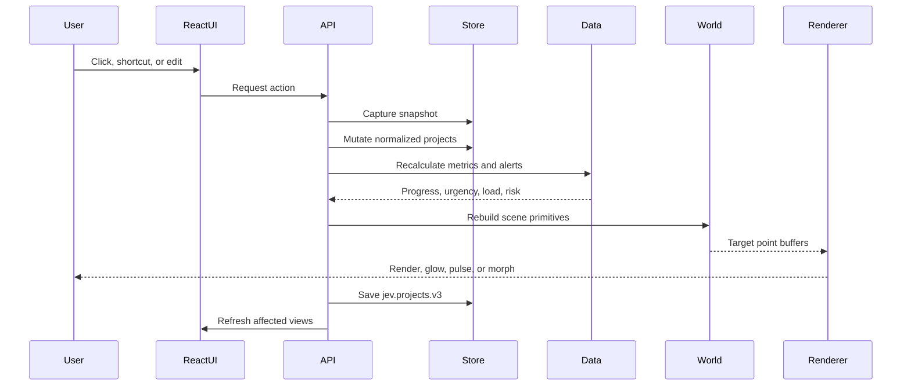

# Application Architecture

## Runtime boundary

```text
index.html
└── src/main.jsx
    ├── installBridge()
    ├── initEngine()
    └── React App
        ├── Header
        ├── Stage
        │   ├── canvas renderer
        │   ├── histogram
        │   └── deadline heatmap
        └── Sidebar
            ├── selected project card
            ├── project list
            └── event log
```

## Module responsibilities

| Module | Responsibility | Tidak boleh menjadi sumber data baru |
|---|---|---|
| `core.js` | Konstanta scene, layer, palette, state runtime, dan utility | Ya |
| `store.js` | Normalisasi, validasi tanggal, localStorage, slot, undo/redo, dan derived metrics | Ya |
| `world.js` | Slot project, primitive point-cloud, dekorasi scene, kendaraan, kereta, dan morph target | Ya |
| `renderer.js` | Proyeksi point-cloud, glow, HUD, task colors, traffic, flight, dan train animation | Ya |
| `runtime.js` | Inisialisasi engine, animation loop, persistence interval, dan cinema camera | Ya |
| `api.js` | Mutasi data, selection, layer, scene, import/export, dan public compatibility API | Ya |
| `bridge.js` | Sinkronisasi event engine dengan rerender React dan visualisasi canvas | Ya |
| `Header.jsx` | Kontrol layer, scene, threshold, bahasa, import/export, dan sample | Ya |
| `Stage.jsx` | Canvas, picker, clock, legend, histogram, dan deadline heatmap | Ya |
| `Sidebar.jsx` | Project card, task actions, list, search, dan event log | Ya |

## Data lifecycle



## Scene adapters

| Scene | Project form | Task form | Dekorasi atau traffic |
|---|---|---|---|
| `city` | Tower, slab, podium, crown, atau spire | Floor band | Grid dan city traffic |
| `satellite` | Station, dish, atau array | Terrace | Terrain dan relay structure |
| `ship` | Cargo stack | Container | Hull, bridge, mast, dan wave motion |
| `factory` | Hall, tank, atau silo | Ring atau tier | Yard, rack, roof, gate, dan movers |
| `airport` | Aircraft form | Jet body | Runway dan take-off animation |
| `metro` | Station form | Station tier | Rail grid dan train animation |

Semua scene membaca project yang sama. Slot disimpan per scene agar perpindahan scene tidak mengacak posisi project.

## State ownership

- Persistent state: projects, tasks, scene, layer, threshold, slot, dan seed.
- Ephemeral UI state: hover, selection, orbit, zoom, pulse, cinema camera, flight, serta train animation.
- Derived state: days left, progress, urgency, open load, risk, alert, histogram, heatmap, dan project ordering.

Derived state harus dihitung ulang setelah mutasi data dan pada tick persistence runtime. Derived state tidak boleh disimpan sebagai fakta permanen di project payload.
