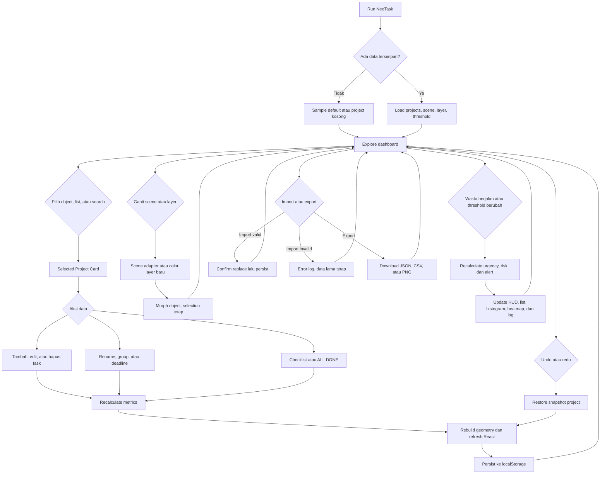

# User Flow

Dokumen ini menjelaskan alur pengguna utama tanpa mengubah perilaku aplikasi.

## Jalur happy path

1. Jalankan aplikasi melalui Vite.
2. Load sample atau buat project baru.
3. Tambahkan task dan due date.
4. Klik task pada project card untuk mengubah status.
5. Gunakan layer `PROGRESS` untuk melihat keterisian pekerjaan.
6. Gunakan `URGENCY` atau `RISK` untuk memprioritaskan project.
7. Gunakan deadline heatmap untuk menemukan group dan hari yang padat.
8. Export JSON sebagai checkpoint.

## Jalur pengecualian

- JSON rusak: aplikasi mencatat error dan tidak menimpa data lama.
- Tanggal tidak valid: perubahan ditolak dan event log mencatat kegagalan.
- Tidak ada project: sidebar menampilkan empty state dan stage tetap menjadi area kerja.
- Semua task selesai: project berstatus `DONE` dan tidak lagi menghasilkan alert.
- Undo atau redo: snapshot data dikembalikan tanpa mengubah struktur aplikasi.
- Scene airport atau metro: animation traffic dapat menghasilkan event visual tambahan saat project selesai.
